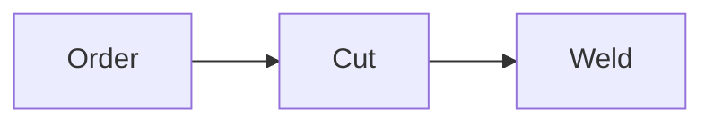

# Content grammar

Every file you write under `content/courses/` is Markdown that the app renders. The app has a fixed set of components; you never write HTML or JSX. A malformed block renders as an error card, so follow the grammar exactly.

## Frontmatter

Every file starts with YAML frontmatter. Required: `title`. Section files also need `order`.

```markdown
---
title: Value stream mapping
order: 2
---
```

## Prose

Plain CommonMark + GFM (tables, lists, bold, links). Headings start at `##` — the app renders `title` as the `#`. One idea per section. See `voice.md`.

## Callouts

```markdown
:::callout{type=note}
One or two sentences. Types: note, tip, warning.
:::

:::predict
A question the reader should answer in their head before reading on. Use before introducing a mechanism, rule, or counterintuitive result.
:::
```

## Diagrams

Only when a structural relationship would serialize badly as prose. Keep labels short; avoid parentheses and quotes inside node labels.

````markdown

````

## Questions

A fenced `quiz` block with a YAML body. Every section ends with one to three. Default to `short`; use `mcq` only when the options are plausible confusions worth discriminating.

````markdown
```quiz
id: q-vsm-01
type: short
prompt: A step adds 3 minutes of work and 2 days of waiting. Which waste is this, and why?
rubric: Names "waiting"; explains that lead time, not work time, dominates.
```

```quiz
id: q-vsm-02
type: mcq
prompt: Which metric does a value stream map add that a flowchart lacks?
options:
  - Step ownership
  - Time spent waiting between steps
  - Number of steps
  - Tooling per step
answer: 1
explanation: Flowcharts show sequence. Value stream maps add lead time and process time per step, which exposes waiting.
```
````

Rules: `id` is unique within the course, stable, and kebab-case (`q-<module>-<nn>`). `answer` is a 0-based index. `mcq` needs `explanation`; `short` needs `rubric`. Keep prompts self-contained — the reader may see the question without the paragraph above it.

## Stable ids

Once a quiz `id` exists, never change it or reuse it. When editing a section, preserve existing ids and mint new ones only for new questions.
