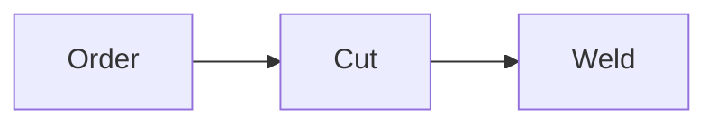

# Content grammar

Every file under `library/content/courses/` is Markdown the app renders with fixed components. No HTML or JSX. A malformed block renders as an error card.

## Frontmatter

YAML between `---` lines. `title` is required; section files also need `order`. Put every prose value in double quotes; escape inner quotes as `\"`. An unquoted colon in one value can drop a whole course.

```markdown
---
title: "Bottom line first: a document rule"
order: 4
---
```

## Prose

CommonMark + GFM. Headings start at `##`; the app renders `title` as the `#`. See `voice.md`.

## Callouts

```markdown
:::callout{type=note}
One or two sentences. Types: note, tip, warning.
:::

:::predict
One question the reader answers in their head before reading on. Once per section, before the mechanism or the counterintuitive result. The next paragraph answers it in its first sentence.
:::
```

## Diagrams

Only for a relation the prose has not already stated, with four or more nodes. Short labels; no parentheses or quotes in node labels.

````markdown

````

## Questions

A fenced `quiz` block with a YAML body. Every section ends with one to three. Default `short`; `mcq` only when the distractors are confusions worth telling apart.

````markdown
```quiz
id: q-02-03
type: short
objective: obj-02-1
prompt: >-
  A step adds 3 minutes of work and 2 days of waiting. Which waste is this, and why?
rubric: >-
  1. Waiting. 2. Lead time, not work time, dominates: two days against three minutes.
  Wrong if: counts only the three minutes, or calls it overprocessing.
```

```quiz
id: q-02-04
type: mcq
objective: obj-02-2
prompt: >-
  Which metric does a value stream map add that a flowchart lacks?
options:
  - Step ownership
  - Time spent waiting between steps
  - Number of steps
  - Tooling per step
answer: 1
explanation: >-
  Flowcharts show sequence. Value stream maps add lead time and process time per step, which exposes waiting.
  "Number of steps" tempts because both diagrams count them; neither one times them.
```
````

Fields:

- `id`: unique in the course; never changed or reused. Patterns, two digits zero-padded: baseline `q-base-01`; section `q-02-03` (module number, question number counted across the module); warm-up review `q-02-r1`; module test `q-02-t03`; drill-down `q-02-dd01`.
- `objective`: the outline objective the question tests, `obj-02-1` (module number, objective position). Required everywhere except the baseline.
- `prompt`: self-contained; the reader may meet it weeks later as spaced review.
- `rubric` (`short`): two to four numbered idea units, then a `Wrong if:` line naming the misconception. The learner may see it as the model answer; write it as one. No grader talk.
- `options` (`mcq`): one line each, no `: ` inside. Every distractor is a misconception from the research files or a neighbouring idea from the module. `answer` is the 0-based index. `explanation`: why the answer is right and why the most tempting distractor tempts.

YAML: write `prompt`, `rubric`, and `explanation` as `>-` block scalars, always. Never a double-quoted scalar with `\"` escapes inside a quiz block. After writing an `mcq`, confirm `options[answer]` is the correct option.
