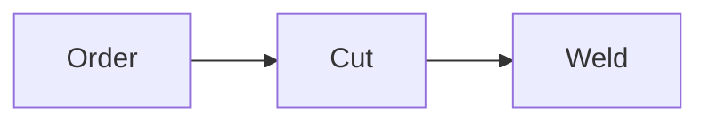

# Content grammar

Every file under `library/content/courses/` is Markdown the app renders with fixed components. No HTML or JSX in the prose; HTML goes only in an `html` fence (see Mocks). A malformed block renders as an error card.

## Frontmatter

YAML between `---` lines. `title` is required; section files also need `order`. Put every prose value in double quotes; escape inner quotes as `\"`. An unquoted colon in one value can drop a whole course.

```markdown
---
title: "Bottom line first: a document rule"
order: 4
---
```

## Prose

CommonMark + GFM. Headings start at `##`; the app renders `title` as the `#`. See `voice.md`.

## Callouts

```markdown
:::callout{type=note}
One or two sentences. Types: note, tip, warning.
:::

:::predict
One question the reader answers in their head before reading on. Once per section, before the mechanism or the counterintuitive result. The next paragraph answers it in its first sentence.
:::
```

## Visuals

A visual earns its place when it shows something the prose would take a paragraph to say: a structure, a flow, a quantity, an interface, a place. Never one that repeats a sentence beside it. Each sits right after the prose that refers to it, and the prose says what to look at. Pick the form by what is shown:

| Showing | Use |
|---|---|
| Steps, states, sequences, entities and relations | `mermaid` |
| Numbers: a comparison, a trend, a distribution | `chart` |
| A screen, a form, a UI pattern, a small interactive model | `html` |
| A comparison across several attributes | a GFM table |
| A scene, a physical object, a place, a metaphor no diagram can draw | a generated image |

### Diagrams

A `mermaid` fence: `flowchart`, `sequenceDiagram`, `stateDiagram-v2`, `erDiagram`, `timeline`, `quadrantChart`. Only for a relation the prose has not already stated, with four or more nodes. Short labels; no parentheses or quotes in node labels.

````markdown

````

### Charts

A `chart` fence holds one [Vega-Lite](https://vega.github.io/vega-lite/) spec as JSON, with the data inline under `data.values`. The app sets width, colours and fonts from the page theme, so omit `width`, `$schema` and colours unless a colour carries meaning. Give every axis a `title`. Real numbers only, each from a source the prose links; an illustrative shape says so in the prose.

````markdown
```chart
{
  "data": {"values": [{"rule": "Min stay", "share": 71}, {"rule": "Booking window", "share": 64}, {"rule": "Blackout dates", "share": 38}]},
  "mark": "bar",
  "encoding": {
    "y": {"field": "rule", "type": "nominal", "title": null, "sort": "-x"},
    "x": {"field": "share", "type": "quantitative", "title": "Parks using the rule, %"}
  }
}
```
````

### Mocks

An `html` fence holds a self-contained fragment: markup, a `<style>` and, when it needs to respond, a `<script>`. It renders in a sandboxed frame with no network, so no external fonts, images, scripts or fetches; draw icons inline as SVG. Use the theme's variables for colour (`var(--fg)`, `var(--bg)`, `var(--muted)`, `var(--faint)`, `var(--line-strong)`, `var(--accent)`, `var(--accent-fill)`) so the mock follows light and dark. Keep it under about 150 lines and 600px tall. A mock shows one pattern; a contrast pair is two mocks, or one mock with a toggle. A mock is never a quiz: questions go in a `quiz` block after it.

````markdown
```html
<style>.row{display:flex;gap:8px;align-items:center;padding:8px 0;border-bottom:1px solid var(--faint)}</style>
<div class="row"><b>Minimum stay</b><input type="number" value="2" style="width:4em"> nights, Fri–Sat only</div>
```
````

### Images

``, the path relative to the file that shows it. Generate one with

```
bun run scripts/gen-image.ts library/content/courses/<slug>/modules/<id>/images/<name>.png "<prompt>" [--aspect 16:9]
```

which saves the image and, beside it, the prompt. Write the prompt as an art brief: subject, composition, style (flat illustration, diagrammatic, photographic), palette, and every text label spelled exactly. Use an image only when no other form above can show it; at most two per module, since each costs money and a minute. Never generate a chart, a diagram, a screenshot of a real product, or a real person's likeness. When the script fails, write the section without the image and say so in the reply.

## Notation

A fenced `abc` block holds one tune in [ABC notation](https://abcnotation.com/wiki/abc:standard:v2.1): one `X:` line per fence; a second tune goes in its own fence. The app engraves it and adds a player, so a reader can hear every phrase. Always set `M:`, `L:`, `K:` and `Q:`; put chord symbols in double quotes before the note they sit on; `%` starts a comment. A space between notes breaks the beam, so write the eighths of one beat group without spaces (`GCD^D`) and keep the space only between groups. Write concert pitch unless the section says otherwise; guitar is the exception: write a guitar part as guitar music is printed, an octave above where it sounds, with `clef=treble-8` on the `K:` line (`K:F clef=treble-8`), and the player sounds it at true pitch. Put the source on a `C:` line: the player, year and transcriber for a phrase from a record, `C:Original, written for this course` for anything else. A phrase taken from a recording names the source and the timestamp in the prose, never only in the block. For a swung phrase in an x/4 or x/8 meter, add `%%MIDI swing 66` after `K:` (50 is straight, 60 light, 66 a triplet feel, 75 the most); the player starts at that feel and lets the reader change it. Notate swung eighths as plain eighths, never as dotted pairs. Every bar fills the meter, except a pickup first bar and its complement at the end; the reader lists a bar that does not, and every parser warning, under the score. Notation never goes inside a `quiz` block: a fence there ends the question early. Put the score in the prose just before the question and refer to it.

````markdown
```abc
X:1
T:ii-V-I in C
M:4/4
L:1/8
Q:1/4=140
K:C
"Dm7" DFAc dcAF | "G7" _AGFE DB,G,F, | "Cmaj7" E4 z4 |]
```
````

## Video

A leaf directive embeds a player for one passage of a YouTube video: it plays from `t` to `end`, and its reset button jumps back to `t`. Use it only for a recording the section quotes, placed right after the prose that cites the moment. `v` is the video id, `t` and `end` are `m:ss`, seconds or `1m43s` (either may carry a decimal, `1:48.5`), `title` is the caption. Quote every value; a value cannot hold a double quote, even escaped, so use single or curly quotes inside a title. Always the two-colon form: `:::youtube` would take in everything after it.

```markdown
::youtube{v="-_lIEU7mz8s" t="1:43" end="1:49" title="Stan Getz, Pennies from Heaven, 1957"}
```

## Questions

A fenced `quiz` block with a YAML body. Every section ends with one to three. Default `short`; `mcq` only when the distractors are confusions worth telling apart; `code` whenever the answer is code the learner writes (a query, a function, a command), so they write it in an editor instead of a text box.

````markdown
```quiz
id: q-02-03
type: short
objective: obj-02-1
prompt: >-
  A step adds 3 minutes of work and 2 days of waiting. Which waste is this, and why?
rubric: >-
  1. Waiting. 2. Lead time, not work time, dominates: two days against three minutes.
  Wrong if: counts only the three minutes, or calls it overprocessing.
```

```quiz
id: q-02-04
type: mcq
objective: obj-02-2
prompt: >-
  Which metric does a value stream map add that a flowchart lacks?
options:
  - Step ownership
  - Time spent waiting between steps
  - Number of steps
  - Tooling per step
answer: 1
explanation: >-
  Flowcharts show sequence. Value stream maps add lead time and process time per step, which exposes waiting.
  "Number of steps" tempts because both diagrams count them; neither one times them.
```
````

A `code` question for SQL runs. The app loads `setup` into a fresh SQLite database, runs the learner's code and the `solution`, and compares the rows they return: a match is correct at once; a mismatch or an error goes to the grader with both results, so the note can say what the query got wrong. The learner can run their query against the data before checking, and sees the `solution` after. Other languages (`python`, `javascript`, `typescript`) get the editor with highlighting but no runner: the grader reads the code against the `rubric`.

````markdown
```quiz
id: q-02-05
type: code
objective: obj-02-2
language: sql
prompt: >-
  The `orders` table holds one row per order. List each customer with their total spend, highest
  first, leaving out customers who have spent less than 100.
setup: |-
  CREATE TABLE orders (id INTEGER PRIMARY KEY, customer TEXT, amount REAL);
  INSERT INTO orders (customer, amount) VALUES
    ('Ana', 60), ('Ana', 70), ('Ben', 40), ('Ben', 30), ('Cai', 250);
starter: |-
  SELECT customer
  FROM orders
solution: |-
  SELECT customer, SUM(amount) AS total
  FROM orders
  GROUP BY customer
  HAVING SUM(amount) >= 100
  ORDER BY total DESC
ordered: true
rubric: >-
  1. Groups by customer and sums the amount. 2. Filters the groups with HAVING, since WHERE runs
  before the sum exists. 3. Sorts by the total, descending.
  Wrong if: filters with WHERE amount >= 100, which drops single orders instead of small spenders.
```
````

Code fields:

- `language`: `sql` (SQLite, runs), `python`, `javascript`, `typescript`.
- `setup` (`sql`): the schema and rows, as a `|-` literal block. Seed the rows so the wrong query the `Wrong if:` line names returns a different result from the right one: above, WHERE drops both of Ana's orders, so Ana, who spent 130, disappears. The learner sees it under a collapsed "The data" beside the editor, and can run queries against it; still name in the prompt the tables and columns the answer needs.
- `solution` (`sql` required): one correct answer, as `|-`. It must return at least one row.
- `check` (optional): a query run after the learner's code, for exercises that change data (`UPDATE`, `INSERT`, `CREATE`): its rows are compared instead of the code's own.
- `ordered: true` only when the prompt asks for an order; otherwise row order is ignored. Column names and aliases are never compared, but column count and order are, so the prompt names the columns it wants in order.
- `starter` (optional): code the editor opens with, as `|-`. It must not already pass.
- `rubric`: as for `short`; the grader uses it to explain a mismatch and to grade languages that do not run.

Code goes in `|-` literal blocks (`>-` would fold its lines), and never contains a triple backtick. Code questions get no review variants.

Fields:

- `id`: unique in the course; never changed or reused. Patterns, two digits zero-padded: baseline `q-base-01`; section `q-02-03` (module number, question number counted across the module); warm-up review `q-02-r1`; module test `q-02-t03`; drill-down `q-02-dd01`; flashcard made in a chat `q-02-fc01`; worksheet exercise `q-02-ws01` (numbered across all the module's worksheets).
- `objective`: the outline objective the question tests, `obj-02-1` (module number, objective position). Required everywhere except the baseline, and the first module test's baseline re-ask when no objective of the module fits it.
- `prompt`: self-contained; Markdown, so name tables and columns in backticks; the reader may meet it weeks later as spaced review.
- `rubric` (`short`): two to four numbered idea units, then a `Wrong if:` line naming the misconception. The learner may see it as the model answer; write it as one. No grader talk. Every unit answers something the prompt asks: the learner sees only the prompt, and the grader scores only what it asks for. To require a contrast ("why the others are not"), a mechanism, or an example, the prompt says so: "Which sentence is plot, why, and why are the others not?"
- `options` (`mcq`): one line each, no `: ` inside. Every distractor is a misconception from the research files or a neighbouring idea from the module. `answer` is the 0-based index. `explanation`: why the answer is right and why the most tempting distractor tempts.

YAML: write `prompt`, `rubric`, and `explanation` as `>-` block scalars, always; code fields as `|-`. Never a double-quoted scalar with `\"` escapes inside a quiz block. After writing an `mcq`, confirm `options[answer]` is the correct option.
