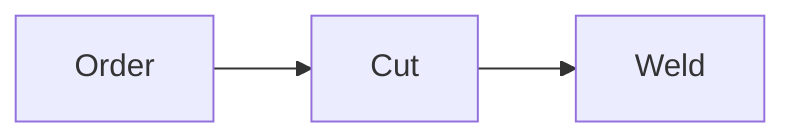

# Technical Feasibility: Agentic Course System

Companion to [vision.md](vision.md). Research backing each section lives in [research/](research/): [claude-code-integration.md](research/claude-code-integration.md), [frontend-stack.md](research/frontend-stack.md), [storage-layer.md](research/storage-layer.md), [learning-science.md](research/learning-science.md). Research date: 2026-10-27.

## 1. Verdict

**Feasible, and most of it is well-trodden.** Local web UIs that spawn Claude Code and stream its output already exist as open-source projects; markdown-rendering three-pane apps with annotation and a rich-text sidebar are standard; SQLite + git for a single user is boring in the good way.

There is exactly one hard dependency and two design choices that deserve a decision before code is written:

| | What | Why it matters |
|---|---|---|
| **Hard dependency** | Headless Claude Code (`claude -p`) must run against your Pro/Max login, not an API key. | Every button in the app is a `claude -p` call. If this doesn't work, the project's "runs locally so it uses my subscription" premise fails. Verify before anything else (§3.1). |
| **Design choice 1** | Modules are **content, not code**. Claude writes Markdown with a fixed set of directives and typed fenced blocks; the app owns the React components that render them. | The vision says "generate the code for a module." Generating React/MDX per module is fragile (one stray `<` blanks the page), breaks highlight anchoring, and needs `eval`. A fixed component library plus a content grammar gets the same visual result with none of that. Raw HTML stays available as an escape hatch (§4). |
| **Design choice 2** | Files are the source of truth for everything Claude writes; SQLite is the source of truth for everything you do. The DB also holds a rebuildable index of the files. | Keeps git meaningful (each generation step is a commit), keeps Claude's job simple (write files), and keeps your notes/answers safe from regeneration. |

Everything else is implementation.

## 2. Architecture

```
┌────────────────────────────────────────────────────────────────────┐
│ Browser  (Vite + React 19, shadcn/ui, Tailwind)                     │
│  ┌──────────┐ ┌────────────────────────┐ ┌───────────────────────┐ │
│  │ Sidebar  │ │ Reading pane           │ │ Notes (Tiptap)        │ │
│  │ outline/ │ │ react-markdown +       │ │   ─ or ─              │ │
│  │ modules  │ │ directives + fences    │ │ Chat (streaming)      │ │
│  │          │ │ selection menu,        │ │                       │ │
│  │          │ │ highlights, quizzes    │ │                       │ │
│  └──────────┘ └────────────────────────┘ └───────────────────────┘ │
└───────────────▲──────────────────────────────────────▲─────────────┘
                │ REST + SSE (/api/events, /api/chat)  │
┌───────────────┴──────────────────────────────────────┴─────────────┐
│ Local server  (Node 22+, Hono)                                      │
│  ┌─────────────┐  ┌──────────────┐  ┌──────────────┐  ┌──────────┐ │
│  │ Job runner  │  │ Indexer      │  │ Annotation   │  │ Git      │ │
│  │ spawns      │  │ chokidar →   │  │ re-anchoring │  │ auto-    │ │
│  │ `claude -p` │  │ parse → DB   │  │              │  │ commit   │ │
│  │ parses NDJSON│ │ → SSE push   │  │              │  │          │ │
│  └──────┬──────┘  └──────▲───────┘  └──────────────┘  └──────────┘ │
│         │ spawn          │ watch                                    │
└─────────┼────────────────┼──────────────────────────────────────────┘
          ▼                │
   ┌─────────────┐   ┌─────┴──────────────────────┐   ┌──────────────┐
   │ claude CLI  │──▶│ content/   (git-tracked)    │   │ data/app.db  │
   │ (your login)│   │  courses/<slug>/...         │   │ (SQLite,     │
   │ + .claude/  │   │  outline.md, modules/*.md,  │   │  gitignored) │
   │   skills,   │   │  research/*.md, quizzes     │   │ data/notes/  │
   │   agents    │   └────────────────────────────┘   └──────────────┘
   └─────────────┘
```

Two entry points share one set of prompts:

- **Terminal:** `/start-course <topic>` runs as a Claude Code skill in your normal interactive session. This is where clarifying questions happen (a TTY makes that natural). It writes the course scaffold and baseline test to `content/`; the indexer picks them up.
- **Web app:** every other action (grade, generate module, drill down, additional reading, chat, end-of-module summary) is a job that the server runs as `claude -p ...` with the same `.claude/skills` and `.claude/agents`, streaming output back to the browser.

## 3. The Claude Code bridge

### 3.1 Authentication — verify first

The Agent SDK docs say third-party developers may not offer claude.ai login for products built on the SDK, and document the SDK as API-key authenticated. That is a distribution policy; it does not stop you from running the `claude` binary you already installed and logged in with. Every open-source Claude Code web UI works by spawning that binary. So:

- **Use the installed CLI, not the SDK.** `spawn("claude", ["-p", ...])` from the server. No `ANTHROPIC_API_KEY` in the environment.
- **Do not use `--bare`** — it skips subscription login.
- **Two-minute check before building anything:**
  ```bash
  env -u ANTHROPIC_API_KEY claude -p "Reply with the word ok" --output-format json
  ```
  If that succeeds and shows up as subscription usage, the premise holds. If it prompts for an API key, the project needs a different premise (API billing, or a "pull" model where your interactive session polls a job queue — workable but clunky).

Whether the SDK's bundled binary would also pick up the CLI login is unverified; don't depend on it.

### 3.2 Invocation model

One job = one `claude -p` process. The server owns a small **job runner**:

```ts
// server/claude/run.ts (sketch)
const child = spawn("claude", [
  "-p", prompt,
  "--output-format", "stream-json", "--verbose", "--include-partial-messages",
  "--permission-mode", "acceptEdits",
  "--allowedTools", "Read,Write,Edit,Glob,Grep,WebSearch,WebFetch,Agent,Bash(git log:*)",
  "--append-system-prompt", systemPromptForJob(job),
  ...(job.sessionId ? ["--resume", job.sessionId] : []),
  ...(job.schema ? ["--json-schema", JSON.stringify(job.schema)] : []),
  "--max-turns", "60",
], { cwd: PROJECT_ROOT, env: { ...process.env, CLAUDE_CODE_MAX_CONCURRENT_SUBAGENTS: "3" } });

for await (const line of readline(child.stdout)) {
  const ev = JSON.parse(line);            // system | assistant | stream_event | result
  db.insert(run_events).values({ run_id, ev });      // persisted so a page reload can replay
  sse.broadcast(`run:${run_id}`, ev);
  if (ev.type === "assistant") recordToolUses(ev);   // Write/Edit → run_outputs rows
  if (ev.type === "result") finishRun(ev);           // session_id, cost, structured_output
}
```

| Need | Mechanism |
|---|---|
| Streaming to browser | NDJSON events → SSE. Persist events per run so reloading the page mid-generation replays progress. |
| Multi-turn chat | Store `session_id` on the `chats` row; each new message runs `claude -p "<msg>" --resume <id>`. Stateless, simple. (Alternative: a long-lived process with `--input-format stream-json`; not needed for v1.) |
| Structured results (grades, outline, understanding summary) | `--json-schema` → `result.structured_output`. Validate with zod; fall back to re-asking once. |
| Research fan-out | `.claude/agents/topic-researcher.md`, `module-researcher.md`, `reading-finder.md`. The top-level job prompt tells Claude to use them in parallel. |
| Which files a run wrote | Parse `Write`/`Edit` tool_use blocks from the stream → `run_outputs`. (A `PostToolUse` HTTP hook could do the same; the stream is already in hand, so hooks are optional.) |
| Write guard | `PreToolUse` command hook that denies `Write`/`Edit` outside `content/` and `data/notes/`. Cheap insurance for a `acceptEdits` process. |
| Concurrency | Account-level rate limits are shared. Run **one generation job at a time** (queue with a visible status), allow a chat to run alongside. Cap subagents at 2–3. |
| Cost/usage | `result.total_cost_usd` is an estimate; log it per run for your own curiosity. Subscription usage is what actually matters — surface a "runs today" counter. |
| Cancel | SIGTERM the child; mark run `cancelled`; files already written stay (they're in git). |

### 3.3 Prompts live in `.claude/`

```
.claude/
  skills/
    start-course/SKILL.md      # /start-course <topic>: clarify, research breadth, scaffold, baseline test
    generate-outline/SKILL.md  # from baseline results → outline.md (objective-keyed)
    generate-module/SKILL.md   # research fan-out → module docs
    grade/SKILL.md             # json-schema graded feedback; appends feedback blocks
    drill-down/SKILL.md
    find-reading/SKILL.md
    module-summary/SKILL.md    # Socratic chat + understanding summary
  agents/
    topic-researcher.md        # breadth, no drilling (step 4)
    module-researcher.md       # depth within one module, scope-locked (step 9)
    reading-finder.md          # books/papers/articles with why-read-it notes
  rules/
    content-grammar.md         # the exact directive/fence grammar + stable-id contract (§4)
    voice.md                   # professor voice, active, concise, no Claudisms, Hemingway/Steinbeck
    pedagogy.md                # prompt-level rules from research/learning-science.md
  settings.json                # hooks (write guard), permissions
CLAUDE.md                      # repo map + "you are the content engine for this course system"
```

Because the web server runs `claude -p` with `cwd` = repo root, both entry points load the same rules. A job prompt can be as short as `/generate-module 03` because the skill carries the instructions.

## 4. Content model

### 4.1 Format: Markdown + directives + typed fences

LLM-written files break at delimiters ([LatentMD](https://deeplearn.org/arxiv/822582/latentmd:-benchmarking-markdown-boundary-failures-in-llm-generated-text): 38% of content-correct outputs had boundary errors). The format must fail **per block, never per page**. Markdown with `remark-directive` containers and fenced data blocks does that; MDX does not.

````markdown
---
id: doc_01HX…            # ULID, never derived from path
kind: lesson
course: lean-methodology
module: 03
title: Value stream mapping
objectives:
  - id: obj_03_1
    bloom: analyze
    text: Identify the seven wastes in a mapped process
---

## Why map the stream {#sec_01HX…}

:::predict{id=pr_01HX…}
Before reading: a process has 12 steps and 40 minutes of actual work per unit. Guess the lead time.
:::

Prose. Claim → mechanism → one concrete example → boundary condition.

:::callout{type=warning}
...
:::



```vega-lite
{ "mark": "bar", "data": { "values": [...] }, "encoding": {...} }
```

```quiz
id: q_01HX…
objective: obj_03_1
type: short-answer
prompt: A step adds 3 minutes of work and 2 days of waiting. Which waste is this, and why?
rubric:
  - names "waiting"
  - explains the work/wait ratio
transfer: ...
```

```html
<!-- escape hatch: sanitized raw HTML for a custom visualization -->
```
````

**Component set the app renders** (fixed, versioned, documented in `.claude/rules/content-grammar.md`): `callout`, `predict`, `quiz` (short-answer, mcq with misconception distractors, cloze), `feedback` (agent-appended, `responds_to`), `reading` (citation card), `mermaid`, `vega-lite`, `chartjs`, `html` (via `rehype-raw` + `rehype-sanitize` allowlist), `embed` (sandboxed iframe to a `content/**/*.html` file for a one-off interactive visualization). New component = app change + grammar doc change; Claude never writes JSX.

### 4.2 Stable IDs — the contract Claude must honour

- Every document has `id` in frontmatter. Every heading, directive, and quiz carries an explicit id (`{#sec_…}`, `{id=…}`, `id:`).
- **Preserve existing ids when editing. Mint new ones only for new blocks. Never renumber.**
- Feedback on a wrong answer is **appended** as a `:::feedback{responds_to=q_…}` block, not a rewrite of the paragraph you misunderstood.
- The indexer lints every write: missing/duplicate/vanished ids become `index_warnings` shown in the UI. Content hashes are version markers, not identity.

This is what makes highlights, notes, answers, and chats survive regeneration.

### 4.3 Rendering pipeline (client)

`GET /api/docs/:id` → markdown string → `react-markdown` v10 with `remark-gfm`, `remark-directive` + a small directive→element plugin, `rehype-raw`, `rehype-sanitize`, and a `components` map. Heading overrides render the ellipsis menu; the `quiz` fence parses YAML, validates with zod, renders the question widget or an error card. Mermaid/Vega are lazy-loaded with per-block error boundaries and a "show source" fallback.

### 4.4 Hot reload

chokidar on `content/` (`atomic: true`, ignore `.tmp.*`, `awaitWriteFinish`) → debounce → parse frontmatter + split into blocks → one SQLite transaction upserting `idx_documents`/`idx_blocks` → re-anchor affected annotations → SSE `{type:"content", docId, changedBlockIds}` → TanStack Query invalidates → pane re-renders. Claude Code writes via temp-file + `rename()` (new inode each write), so watch directories, never file handles. On startup, reconcile the tree against `index_state`.

## 5. Storage

| Layer | Holds | Truth? | Git? |
|---|---|---|---|
| `content/` (markdown, research notes, quizzes, outlines, understanding summaries) | everything Claude writes | **yes** | yes — auto-commit after each run with a `Run-Id:` trailer |
| `data/notes/*.md` | your notes (Tiptap markdown) | yes | yes (optional, recommended) |
| `data/app.db` — `idx_*` tables | parsed index of `content/` | no — rebuildable (`pnpm reindex`) | no |
| `data/app.db` — everything else | answers, confidence, highlights, chats, progress, runs, FSRS cards | **yes** | no; optional scheduled NDJSON export under `data/export/` for history |

Stack: Node 22+ · `better-sqlite3` · Drizzle ORM + drizzle-kit · chokidar 5 (6 once it settles) · `gray-matter` + `remark` for parsing · `ts-fsrs` · `simple-git` or `execFile('git')`.

Full draft schema (courses, modules, agent_runs, run_outputs, content_versions, research_artifacts, quizzes/questions/attempts/answers, notes, annotations, chats/messages, drill_downs, module_progress, module_understanding, review_cards/logs): [research/storage-layer.md](research/storage-layer.md). Two rules worth restating: user-state tables reference `doc_id`/`block_id` as plain strings with **no foreign key into `idx_*`** (a rebuild or a deleted block must never cascade into your data), and every run and annotation records the git SHA so old text is always recoverable.

### 5.1 Annotation anchoring

Store W3C Web Annotation selectors scoped to the block: `TextPositionSelector` (offsets into the block's plain text), `TextQuoteSelector` (exact + prefix/suffix), block id, block hash at creation. Re-anchor on render: block unchanged → positions; block changed → quote at position → exact search → fuzzy → widen to doc → `orphaned` (kept, shown as "from a previous version"). Paint with the **CSS Custom Highlight API** so React re-renders can't orphan `<mark>` wrappers. ~150 lines hand-rolled, or `@recogito/text-annotator` 4.x if you'd rather not.

## 6. Frontend

| Concern | Choice | Notes |
|---|---|---|
| App | Vite 8 + React 19 + TypeScript SPA; Hono API on `@hono/node-server`; Vite in middleware mode for one process | No SSR needed on localhost. TanStack Start 1.0 is the runner-up if you want file routes. |
| UI kit | shadcn/ui + Tailwind v4; `Resizable` (react-resizable-panels v4) with `autoSaveId` | Three panes; left collapsible; right toggles Notes/Chat with both kept mounted. |
| Reading pane | react-markdown + directives (§4.3) | Scroll-spy for the sidebar; `scroll-margin` on headings. |
| Selection menu | `@floating-ui/react` with a virtual element over the `Range` (+ `inline` middleware) | Actions: Add to Note · Drill Down (optional prompt) · Find Additional Reading · Chat. Same menu as an ellipsis next to headings, scoped to the section. |
| Highlights | selectors in SQLite, Custom Highlight API painting (§5.1) | Click a highlight → its note / drill-down / chat. |
| Notes | Tiptap 3 + `@tiptap/markdown` + StarterKit, TaskList, Link, Placeholder | "Add to Note" inserts a blockquote with `data-annotation-id`; debounced save to `data/notes/<module>.md`. Also used for the end-of-module summary. |
| Chat | Hono route emits Vercel AI SDK **UI Message Stream** from the `claude -p` NDJSON; client `useChat` + `streamdown` | Tool calls map to tool parts → "Searching the web…", "Reading module 3…". `assistant-ui` can sit on top later. |
| Charts | Mermaid (pin a major), Vega-Lite via `vega-embed`, Chart.js optional | Lazy-loaded, error boundary per block. |
| State | TanStack Query for server data; SSE `/api/events` for invalidation and run progress | |

## 7. Vision steps → mechanisms

| # | Vision step | Mechanism |
|---|---|---|
| 1–3 | `/start-course <topic>`, clarifying questions (depth) | `.claude/skills/start-course/SKILL.md` run in your interactive terminal session. Asks depth/scope/goals, writes `content/courses/<slug>/course.md` (frontmatter: title, depth, goals). |
| 4 | Breadth research via subagents | Skill fans out 3–5 `topic-researcher` subagents (breadth only, no drilling) → `research/breadth-*.md` + `research/map.md` (the talking-point map). |
| 5 | Course created in local system | Indexer sees `course.md` → `courses` row; auto-commit `gen(course): …`. |
| 6 | Open course in local site | Course list from `courses`; course page shows status (baseline pending / outline pending / modules). |
| 7 | Baseline test | Skill step writes `quizzes/baseline.md` (`kind: baseline`; MC with misconception distractors + short-answer + a 3-point confidence rating per item; framed as a learning event). Indexed into `quizzes`/`quiz_questions`. |
| 8 | Assess + generate outline | Submit → `quiz_attempts`/`quiz_answers` → job `grade` (json-schema: per-objective level estimate) → job `generate-outline` reads research map + grades → `outline.md` (modules, each with objectives, Bloom level, threshold-concept flags; stays at module level). Indexed into `modules`. |
| 9 | Start a module → drill-down research | Button → job `generate-module <id>` → `module-researcher` subagents (scope-locked to the module's objectives; external sources, literature) → `modules/03/research/*.md` + `research_artifacts`. |
| 10 | Generate the module | Same job, second phase: write `modules/03/01-….md` … per section following the grammar (§4), reading `module_understanding` summaries of earlier modules. Indexer + SSE hot-reload each file as it lands; UI shows sections appearing. Commit on finish. |
| 10 | Layout | §6. |
| 11 | Voice, active-reading checks, learning tactics | `.claude/rules/voice.md` + `pedagogy.md`; `quiz` and `predict` fences; on submit → job `grade` (json-schema) → `quiz_answers.feedback_md` **and** an appended `:::feedback{responds_to=q_…}` block in the doc, so "the doc gets updated with what I missed". Spaced items from earlier modules pulled into module quizzes via `review_cards` (ts-fsrs). |
| 12 | Action menu | Add to Note → `annotations` + Tiptap insert. Drill Down → job `drill-down` (optional guidance) → `modules/03/drilldowns/<id>.md` + `drill_downs` row, linked from the highlight. Additional Reading → job `find-reading` → `readings/<id>.md` with `reading` cards. Chat → `chats` row scoped to block/annotation; right pane swaps to chat; `--resume` per message. |
| 13 | End-of-module summary + Socratic chat | "Teach it to a smart colleague with one worked example" in Tiptap → job `module-summary` opens a chat scoped `module_summary`: finds missing idea units, asks for a counterexample, plants a plausible wrong claim, asks for a new-case application, stops ~5 exchanges. Hint ladder; answers withheld by design and said so. |
| 14 | Mark done, next item | `module_progress`; mastery gate = objectives met by unassisted recalls (never from an assisted solve). Unmet objectives carry into the next module's warm-up. |
| 15 | Understanding summary for future generation | Same job's final step (json-schema): objectives met/unmet with evidence, confusions, calibration notes → `module_understanding` row **and** `modules/03/understanding.md` so later `generate-module` runs read it as a file. |

## 8. Pedagogy built in (from research/learning-science.md)

The vision already lands on the two highest-evidence techniques (retrieval practice, feedback). The research adds these, each cheap to build because they are prompt rules plus a column or two:

1. **Objective-keyed backward design** — the outline is a list of objectives (Bloom verb + level + id); sections and checks reference them. Grading and progress key off objective ids, not pages.
2. **Short-answer by default, MC only with competitive (misconception) distractors**; explanation feedback, not just correct/incorrect.
3. **Confidence rating (1–3) before feedback** on every check → hypercorrection framing on confident errors, scheduler priority, per-module calibration score.
4. **Pretesting**: the baseline test and `predict` blocks before each mechanism-introducing section (pretesting ≥ post-testing in direct comparison).
5. **Spaced review across modules** — ~30% of each module quiz comes from earlier objectives, scheduled by FSRS; "learned" = 3 correct spaced recalls.
6. **Tutor hint ladder, not open-ended Socratic loops** — the 2024–26 RCTs that worked used targeted hints with a required attempt and a withheld final answer; vanilla-answer tutors made students worse on unassisted tests, and pure question-only tutors showed nulls. The chat system prompt encodes the ladder.
7. **Per-objective level dial** from the diagnostic: novice gets worked → faded → problem and high-coherence prose; proficient gets problem-first and tighter prose (expertise reversal).
8. **Coherence discipline**: no seductive details; diagrams only with a stated structural reason; one idea per section, 150–350 words.

A caution the research turned up: the most-cited positive meta-analysis on ChatGPT and learning (Wang & Fan 2025) was retracted in April 2026. The credible evidence is the handful of RCTs cited in the research doc.

## 9. Repository layout

```
learning/
  vision.md  tech-feasibility.md  research/
  CLAUDE.md  .claude/{skills,agents,rules,settings.json}
  app/
    package.json           # pnpm workspace or single package
    server/                # Hono: api/, claude/ (runner, ndjson parser, job queue), indexer/, git/, db/ (drizzle schema + migrations)
    client/                # Vite + React: panes/, content/ (markdown pipeline + components), annotate/, notes/, chat/
    shared/                # zod schemas: frontmatter, quiz fence, job payloads, json-schemas sent to claude
  content/
    courses/<slug>/
      course.md  outline.md
      research/            # breadth research (step 4)
      quizzes/baseline.md
      modules/<nn>/
        research/  01-*.md 02-*.md …  quiz.md  drilldowns/  readings/  understanding.md
  data/
    app.db (gitignored)  notes/  export/
```

## 10. Build plan

Effort assumes one person working with Claude Code; each phase ends with something you can actually use for a real course.

**Phase 0 — Spike (half a day).** Verify §3.1. Spawn `claude -p --output-format stream-json`, parse NDJSON, stream to a bare HTML page. Write one skill and one subagent and run them headlessly. If this works, nothing else is risky.

**Phase 1 — Read a course (1–2 weeks).** Repo skeleton, Drizzle schema, indexer + chokidar + SSE, content grammar v1 (callout, quiz, mermaid), react-markdown pipeline, three-pane layout, `/start-course` skill (research fan-out, scaffold, baseline), `generate-outline` and `generate-module` skills, job runner with one-at-a-time queue and live progress. Outcome: you can run `/start-course`, open the site, take the baseline, get an outline, generate a module, and read it.

**Phase 2 — Interact (1–2 weeks).** Grading job with json-schema + appended feedback blocks; selection menu; annotations with re-anchoring; Tiptap notes with "Add to Note"; chat pane with `--resume` and UI Message Stream; drill-down and additional-reading jobs. Git auto-commit with `Run-Id` trailer.

**Phase 3 — Teach (1 week).** End-of-module summary → Socratic chat with hint ladder → understanding summary file; module progress + mastery gate; confidence ratings; `predict` blocks; FSRS review cards and cross-module review items in module quizzes.

**Phase 4 — Polish (ongoing).** Vega-Lite/Chart.js, `embed` for custom HTML visualizations, index-warning UI, run history/cost view, NDJSON export of user state, `pnpm reindex`, calibration view, optional `assistant-ui`.

## 11. Risks and mitigations

| Risk | Likelihood | Mitigation |
|---|---|---|
| Headless CLI doesn't bill to subscription / policy changes | low–medium | §3.1 spike first. Fallback: API key with `--max-budget-usd` per run, or interactive-session "pull" queue. |
| Rate limits with many subagents | medium | One generation job at a time; `CLAUDE_CODE_MAX_CONCURRENT_SUBAGENTS=2–3`; queue UI; retries with backoff on 429. |
| Claude breaks the content grammar or renumbers ids | medium early, low once rules settle | Per-block failure, lint warnings, `content-grammar.md` with examples, a `validate-content` script the skill runs before finishing (`!`pnpm validate``). |
| Module generation takes 10–20 min | certain | It's a background job: persisted events, SSE replay on reload, sections hot-load as written so you can start reading. |
| Highlights orphaned after regeneration | low with stable ids | Append-only feedback convention; fuzzy re-anchor; orphans kept with the git SHA. |
| Slash-command prompts under `-p` (e.g. `claude -p "/generate-module 03"`) behave differently than interactive | low | Unverified in research; test in Phase 0. Fallback: the job runner expands the skill body into the prompt itself. |
| Tutor drifts into giving answers | medium | Hint-ladder system prompt; "answer requests without attempt" counter; never mark objectives met from assisted solves. |
| Mermaid 12 breaking changes; chokidar 6 is a week old | low | Pin Mermaid 11.x; use chokidar 5 for now. |
| Custom Highlight API support in your browser | low | Fallback renderer with `<mark>` spans inside a `useLayoutEffect` if needed. |

## 12. Decisions to make before Phase 1

1. **Confirm the spike result** (§3.1). Everything hinges on it.
2. **Modules as content, not code** (§1, design choice 1) — accept the fixed component library + `html`/`embed` escape hatch, or push for per-module generated React (not recommended).
3. **Notes location**: `data/notes/*.md` in git (recommended — Claude can read them when tutoring and they survive a DB reset) vs. DB-only.
4. **Runtime**: Node + better-sqlite3 (recommended, widest ecosystem) vs. Bun + bun:sqlite.
5. **Chat protocol**: AI SDK UI Message Stream + `useChat` (recommended, tool steps for free) vs. hand-rolled SSE.
6. **Course directory as part of this repo vs. a separate git repo per course** — a single repo is simpler; per-course repos make sharing a course easier. Single repo recommended to start.
